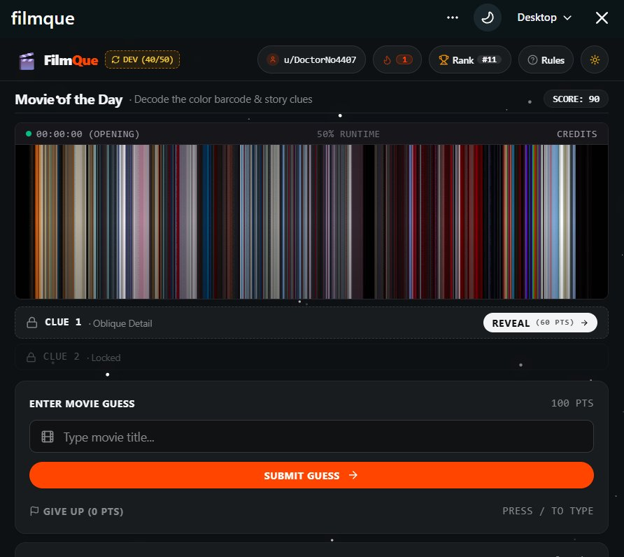
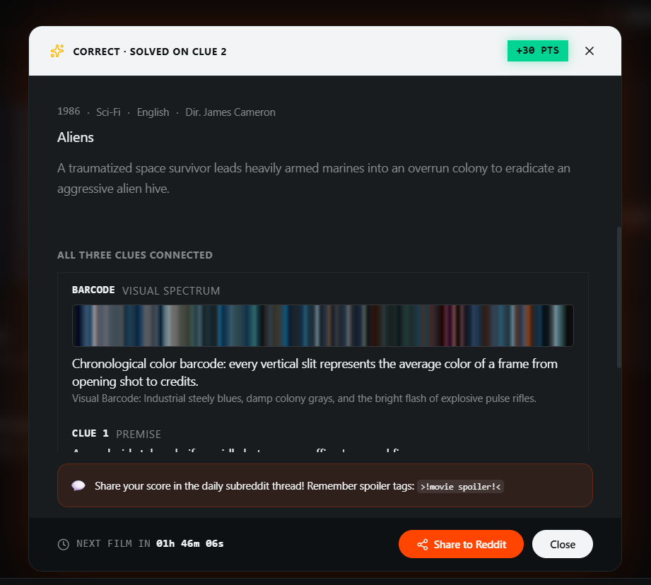

<div align="center">

# 🎬 FilmQue

**A daily movie-guessing game built for Reddit communities, powered by Devvit & React.**

Decode the *Movie of the Day* from its chronological **color barcode** spectrum.

[](https://developers.reddit.com/)
[](https://react.dev/)
[](https://www.typescriptlang.org/)
[](https://tailwindcss.com/)
[](https://hono.dev/)
[](LICENSE)

</div>

---

## 📖 Overview

Every film has an indelible visual DNA. In **FilmQue**, an entire 2-hour cinematic journey is condensed into a single **chronological color barcode**—where every vertical slit represents the dominant color palette of a frame, moving sequentially from opening shot to credits.

Built as an interactive custom post for Reddit's Developer Platform (**Devvit**), FilmQue creates a daily ritual for film enthusiasts: guess the mystery film from its palette alone, unlock narrative clues if you need help, maintain your daily streak, and share your score into the daily subreddit discussion thread.

---

## 📸 Screenshots & Video Demo

<div align="center">

### 📺 Watch the Gameplay Walkthrough
[](https://youtu.be/qgBYEc3njbk)

<p><em>Click the badge above or visit <a href="https://youtu.be/qgBYEc3njbk">https://youtu.be/qgBYEc3njbk</a> to watch the live gameplay walkthrough.</em></p>

</div>

<br/>

| **In-Game Play Stage** | **Result Modal & Reddit Share** |
| :---: | :---: |
|  |  |
| *Visual color barcode spectrum, clue reveal triggers, and guess input.* | *Round summary, all clues revealed, and 1-click Reddit comment share.* |

---

---

## 🎮 How the Game Works

Players have unlimited tries to guess the mystery film, with points awarded based on when the film is solved:

| Stage | Clue Type | Points | Description |
| :---: | :--- | :---: | :--- |
| **1** | **Visual Barcode** | **100 PTS** | Pure color spectrum timeline from opening sequence to credits. |
| **2** | **Clue 1 (Oblique Detail)** | **60 PTS** | A memorable, specific scene, prop, or odd moment. Reveals nothing about genre, premise, or character names. |
| **3** | **Clue 2 (Core Premise)** | **30 PTS** | The hero's situation or central conflict in one spoiler-free sentence (6–12 words). |
| **—** | **Give Up / Pass** | **0 PTS** | Forfeit to reveal the title, year, director, and connection summary. |

---

## ✨ Features

- 🎞️ **Cinema Timeline Ruler:** Barcode frame with real-time cues (`00:00:00 OPENING` $\rightarrow$ `50% RUNTIME` $\rightarrow$ `CREDITS`) with pixelated color fidelity.
- 🛡️ **Cryptographic Anti-Cheat Pipeline:** Movie barcode files are SHA-256 hashed at build time and served via opaque proxy routes. Inspecting the image element in DevTools reveals only hash tokens (e.g. `485bcef7b62a007c`), keeping the answer completely safe from browser snooping.
- 📐 **Zero-Scroll Compact Layout:** Custom-engineered to fit the strict viewport heights of Reddit's mobile and desktop webview iframes without double-scrollbars.
- 🤖 **Native Reddit User Context:** Automatically identifies signed-in Redditors (`u/username`), tracks streaks, and awards community standings.
- 💬 **Reddit-Formatted Share:** One-click copy generates spoiler-safe emoji result grids formatted for pasting directly into the daily subreddit comments.
- 🔍 **Fuzzy Autocomplete & Aliases:** Instant search with keyboard navigation (<kbd>Enter</kbd> / arrow keys / `/`), subtitle matching, sequel handling, and duplicate-guess prevention.
- 🌓 **Reddit Dark & Light Themes:** Themed to match Reddit's native `#0e1113` dark mode and clean light mode, complete with Reddit orange accents (`#ff4500`).
- 📚 **Curated Library:** 50 iconic films spanning classics to modern masterworks, all validated against strict word-count and spoiler-free clue guidelines.

---

## 🏗️ Architecture

FilmQue follows Devvit's dual-runtime architecture:

```
FilmQue/
├── filmque/                         # Devvit Reddit Application
│   ├── devvit.json                  # Devvit manifest & custom post config
│   ├── public/                      # Static assets & barcode image library
│   ├── scripts/
│   │   └── generate-barcode-manifest.cjs # SHA-256 asset hasher & manifest generator
│   └── src/
│       ├── client/                  # Sandboxed React Webview (runs inside Reddit)
│       │   ├── components/          # GameBoard, ResultModal, FloatingNav, RulesModal
│       │   ├── data/movies.ts       # 50 validated curated films & clues
│       │   ├── utils/               # Matching algorithms, sound engine, local storage
│       │   └── App.tsx              # Main game orchestration
│       ├── server/                  # Hono Server (runs on Reddit's infrastructure)
│       │   ├── routes/api.ts        # Barcode proxy routes, counter endpoints
│       │   └── index.ts             # Server entrypoint
│       └── shared/                  # Type-safe schemas & barcode hash manifest
└── src/                             # Standalone web mirror for local development
```

---

## 🚀 Getting Started

### Prerequisites

- **Node.js** `>= 22.0.0`
- **npm** `>= 10.0.0`
- [Devvit CLI](https://developers.reddit.com/docs/quickstart) (for deploying to Reddit)

### Installation

1. **Clone the repository:**
   ```bash
   git clone https://github.com/your-username/FilmQue.git
   cd FilmQue
   ```

2. **Install dependencies:**
   ```bash
   cd filmque
   npm install
   ```

3. **Generate the Barcode Hash Manifest:**
   ```bash
   node scripts/generate-barcode-manifest.cjs
   ```

---

## 🛠️ Development & Commands

Run all commands from the `filmque/` directory:

| Command | Description |
| :--- | :--- |
| `npm run dev` | Starts the Devvit playtest environment connected to your test subreddit |
| `npm run build` | Hashes barcode assets, compiles client webview, and bundles the Hono server |
| `npm run login` | Authenticates your CLI with Reddit Developer platform |
| `npm run deploy` | Type-checks, lints, and uploads a new version to Devvit |
| `npm run launch` | Submits your application for Reddit App Directory review |

---

## 🧩 Tech Stack

- **Platform:** [Reddit Devvit](https://developers.reddit.com/) (Interactive Custom Posts)
- **Frontend:** [React 19](https://react.dev/), [Tailwind CSS v4](https://tailwindcss.com/), [Framer Motion](https://motion.dev/)
- **Backend:** [Hono](https://hono.dev/) on Node server runtime
- **Icons:** [Lucide React](https://lucide.dev/)
- **Bundler:** [Vite](https://vite.dev/) & [Rolldown](https://rolldown.rs/)
- **Security:** SHA-256 cryptographic asset obfuscation

---

## 🗺️ Roadmap

- [x] 50-film curated barcode pool with dual-stage oblique clues
- [x] Cryptographic anti-cheat asset proxy
- [x] Reddit webview compact responsive UI
- [x] First-visit rules onboarding & spoiler-safe Reddit markdown sharing
- [ ] **Devvit Cron Scheduler:** Automated midnight rollover to create and pin the new daily post in the subreddit
- [ ] **Devvit Redis Integration:** Community-wide daily solve statistics and persistent cross-device streak tracking
- [ ] **Automated User Flairs:** Granting subreddit user flairs based on solve streaks (e.g. `🎬 100pt Barcode Master`)
- [ ] **Moderator Queue Tools:** Devvit form for moderators to review, reorder, and schedule upcoming films

---

## 📄 License

This project is licensed under the BSD-3-Clause License - see the [LICENSE](LICENSE) file for details.

<div align="center">
<sub>Crafted with collective joy for the Reddit developer community.</sub>
</div>
